# TP5 - Contratación digital de seguros

Trabajo práctico de **Diseño UX-UI 2026**.

El proyecto reproduce el flujo obligatorio de contratación de un seguro de celular tomando como referencia el Figma indicado en la consigna. Está desarrollado con HTML5, Tailwind CSS v4, Basecoat UI y JavaScript vanilla.

## Sitio publicado

**Netlify:** https://tp5-seguros.netlify.app/

## Cómo ejecutarlo

El proyecto usa `fetch()` para cargar `data/planes.json`, por lo que no debe abrirse con doble clic usando `file://`.

Desde Visual Studio Code se puede ejecutar con **Live Server**.

También se puede usar:

```bash
npx serve .
```

## Estructura

```text
TP5-Seguros/
├── index.html
├── assets/
│   └── screenshots/
│       ├── mobile-inicio.png
│       ├── mobile-cotizacion.png
│       ├── mobile-planes.png
│       ├── mobile-datos.png
│       ├── mobile-pago.png
│       ├── mobile-error.png
│       ├── mobile-exito.png
│       ├── desktop-cotizacion.png
│       ├── desktop-planes.png
│       ├── desktop-datos.png
│       ├── desktop-pago.png
│       └── flujo-responsive-general.jpg
├── css/
│   └── tokens.css
├── data/
│   ├── planes.json
│   └── planes-bicicleta.json
├── js/
│   ├── app.js
│   ├── estado.js
│   ├── render.js
│   ├── validaciones.js
│   ├── cotizador.js
│   └── pago.js
└── README.md
```

## Flujo

1. Inicio / catálogo.
2. Cotización del celular.
3. Selección de plan.
4. Datos personales.
5. Pago simulado.
6. Éxito y número de póliza.
7. Error de pago.

Toda la información vive en un único objeto `solicitud`. Al avanzar o volver entre pasos los datos se conservan y el DOM se vuelve a pintar desde ese estado.

## Reglas implementadas

- Plan Básico: 4 % anual.
- Plan Plus: 6 % anual.
- Plan Premium: 9 % anual.
- Factores por antigüedad: 1,00 / 1,10 / 1,25.
- Validaciones con mensajes en línea.
- Errores mostrados al salir del campo.
- Botones de avance deshabilitados mientras falten datos válidos.
- Resumen generado desde el estado.
- Pago simulado con espera de 1,5 segundos.
- Póliza con formato `POL-AAAA-NNNNNN`.

## Tarjetas de prueba

- `4111 1111 1111 1111`: pago aprobado.
- `4000 0000 0000 0002`: pago rechazado.
- Cualquier otro número de 16 dígitos válido: aprobado.

No se deben usar datos reales de tarjetas.

## Casos de prueba del cotizador

| Valor | Antigüedad | Básico | Plus | Premium |
|---|---|---:|---:|---:|
| $600.000 | Menos de 1 año | $2.000 | $3.000 | $4.500 |
| $600.000 | 1 a 2 años | $2.200 | $3.300 | $4.950 |
| $1.200.000 | Más de 2 años | $5.000 | $7.500 | $11.250 |

## Decisiones tomadas

- Se usa una sola `index.html` y cada pantalla es una sección con `data-paso`.
- La navegación se resuelve cambiando `solicitud.paso` y llamando a `render()`.
- El resumen se genera desde el estado y no se usa para hacer cálculos.
- Los planes se cargan desde `data/planes.json`.
- Se trabaja mobile-first y a partir de `lg` se usa el layout de dos columnas indicado para desktop.
- Se usan componentes de Basecoat cuando están disponibles y Tailwind para layout y responsive.
- Se mantuvo una jerarquía visual simple, con stepper de progreso, validaciones visibles y resúmenes persistentes para acompañar al usuario durante la contratación.

## Bonus

Se implementó **Seguro de Bicicleta** reutilizando el mismo flujo de contratación.

El bonus comparte el estado general, stepper, datos personales, resumen, pago simulado y pantallas de éxito/error. Para Bicicleta se definieron estas reglas como decisión propia de implementación:

- Campos de cotización: marca, tipo de bicicleta, valor y antigüedad.
- Valor permitido: $50.000 a $5.000.000.
- Básico: 3,6 % anual — robo con violencia.
- Plus: 5,4 % anual — robo con violencia + daño accidental.
- Premium: 7,2 % anual — robo con violencia + daño accidental + hurto/pérdida.
- Plus queda preseleccionado y marcado como recomendado.
- Se reutilizan los mismos factores de antigüedad del cotizador principal.

Estas reglas pertenecen únicamente al bonus. Las reglas obligatorias del seguro de Celular se mantienen sin cambios.

## Capturas responsive

La interfaz fue verificada en los tamaños solicitados para la entrega:

- **Mobile:** 390 px de ancho.
- **Desktop:** 1440 px de ancho.

### Vista general

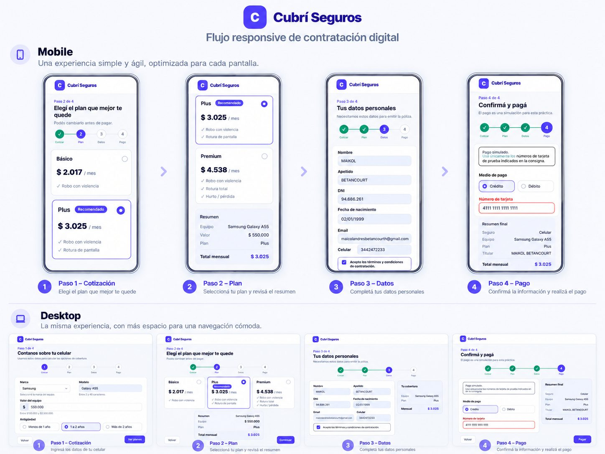

### Mobile

#### Inicio / catálogo

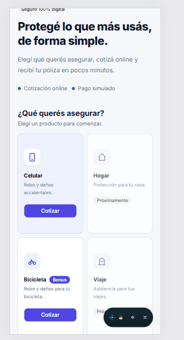

#### Paso 1 - Cotización

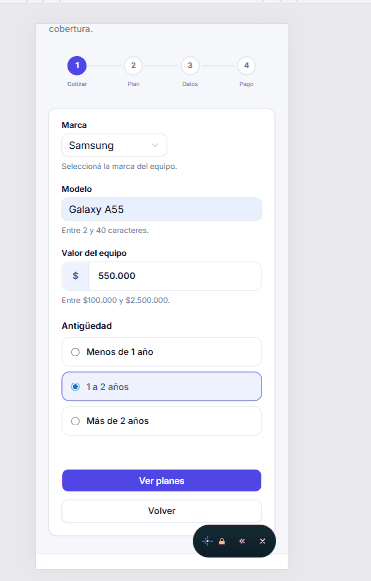

#### Paso 2 - Selección de plan

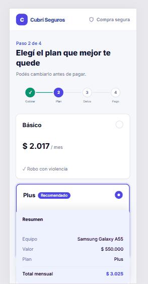

#### Paso 3 - Datos personales

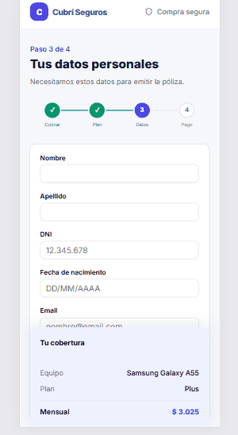

#### Paso 4 - Pago

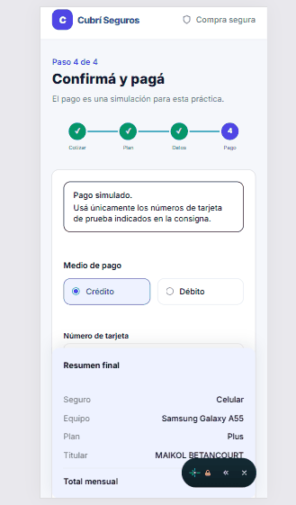

#### Pago rechazado

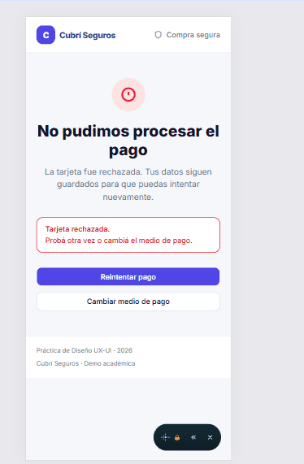

#### Contratación exitosa

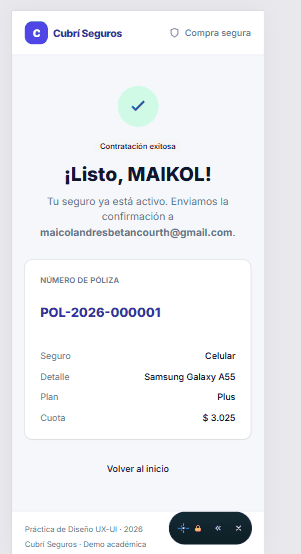

### Desktop

#### Paso 1 - Cotización

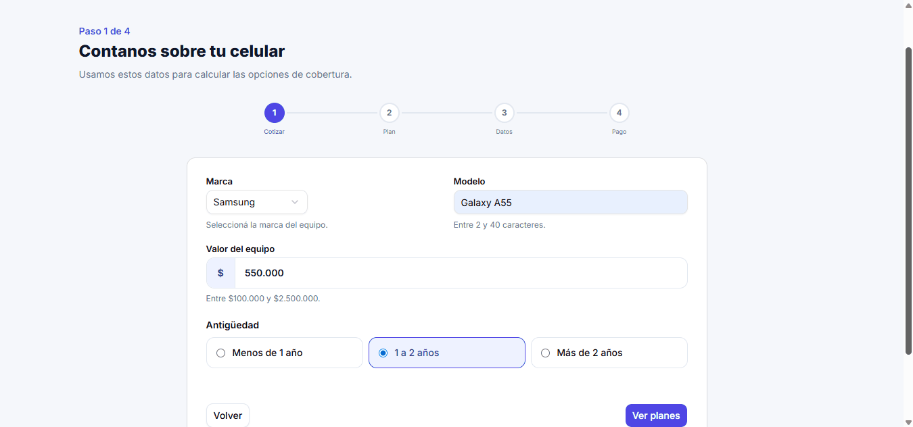

#### Paso 2 - Selección de plan

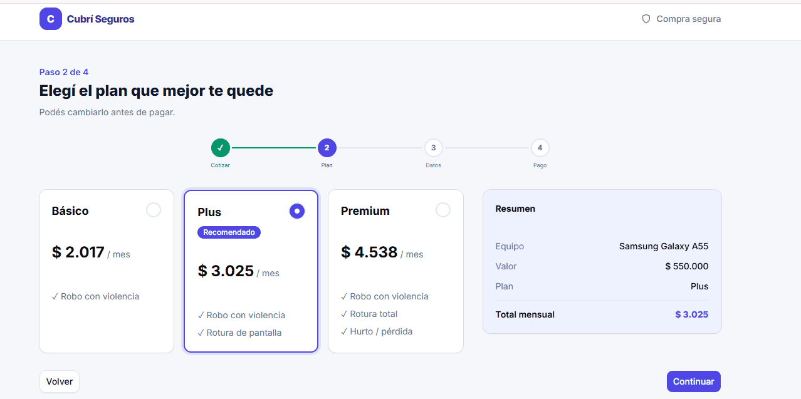

#### Paso 3 - Datos personales

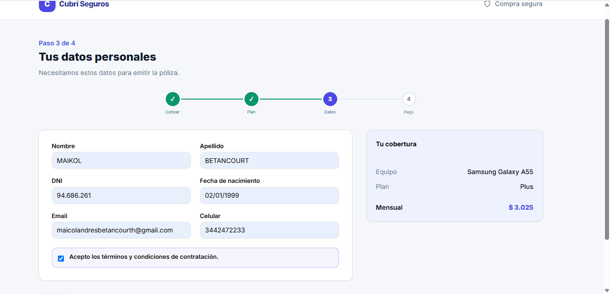

#### Paso 4 - Pago

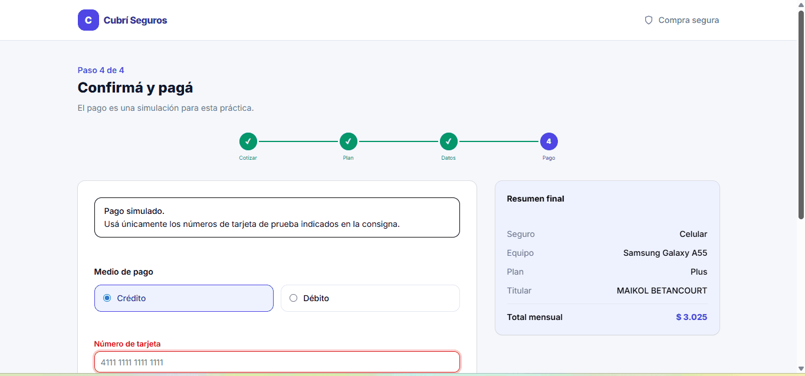

## Publicación

El sitio se encuentra publicado y disponible en:

**https://tp5-seguros.netlify.app/**

## Autor

Maikol Andrés Betancourt Castaño  
Licenciatura en Sistemas de Información  
Diseño UX-UI - 2026
