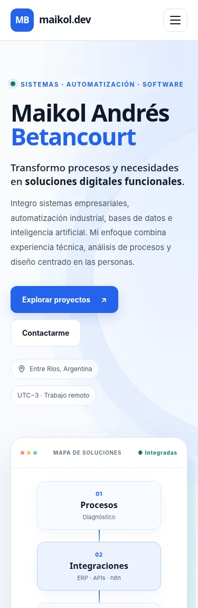
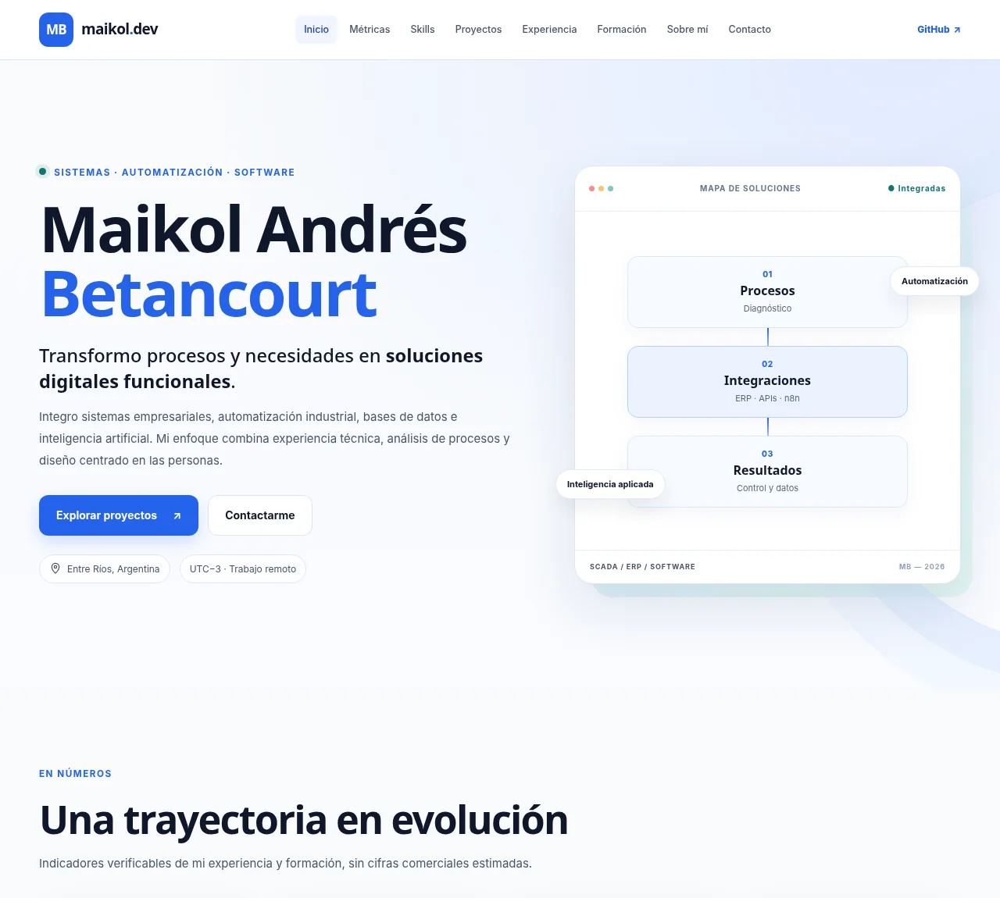

# Trabajo Final — Diseño UX/UI 2026

**Portfolio profesional de Maikol Andrés Betancourt** · Licenciatura en Sistemas de Información · FCyT-UADER · Mg. Ernesto Ledesma.

> **Estado:** prototipo web funcional y documentado. **No es una entrega final cerrada:** restan la página completa de alta fidelidad en Figma, tres pruebas reales con usuarios, revisión entre pares, publicación CI/CD y captura Lighthouse del sitio público. No se presentan resultados simulados como si fueran pruebas realizadas.

## Enlaces

- **Archivo Figma del trabajo:** https://www.figma.com/design/Ls1mpNP9BDDakTddtmAEDO
- **Sitio publicado:** pendiente de conectar Netlify con este repositorio y verificar HTTPS. No se inventa una URL.
- **SC Soluciones Conectadas:** https://scsolucionesconectadas.com.ar/
- **TP5 Cubrí Seguros:** https://tp5-seguros.netlify.app/

## Objetivo

Mostrar de manera clara experiencia laboral, habilidades, formación y proyectos reales ante dos perfiles de usuario: reclutadores IT y clientes que buscan soluciones tecnológicas. El portfolio debe permitir identificar experiencia, abrir un proyecto y localizar contacto en menos de 30 segundos (hipótesis que se validará con usuarios).

## Contenido y estructura

El sitio conserva los **9 bloques obligatorios** de la consigna: `Header`, `Hero`, `Métricas`, `Skills`, `Proyectos`, `Experiencia / Formación`, `Sobre mí`, `Contacto` y `Footer`. Se integró un catálogo filtrable de certificaciones y dos páginas internas de casos de estudio:

- `caso-cubri.html`: caso académico UX/UI con capturas **reales** del TP5.
- `caso-agrimensura.html`: caso profesional con información general autorizable y mockup conceptual; **sin código ni datos privados**.

## Tecnologías

- HTML5 semántico.
- CSS3 puro, Grid, Flexbox, variables CSS y media queries.
- JavaScript vanilla (menú mobile, filtros y mejoras progresivas).
- Inter y Space Grotesk (Google Fonts, con `display=swap`).
- SVG propios y dos capturas WebP del TP5.
- Sin React, Vue, Next.js, Tailwind CDN ni herramientas de construcción visual de webs.

## Uso local

Desde esta carpeta:

```bash
python -m http.server 4173
```

Luego abrir `http://localhost:4173/`. También puede abrirse `index.html` directamente; las rutas relativas están preparadas para hosting estático. No requiere `npm install` ni claves privadas.

## Investigación UX y Figma

- **Proto-persona** y escenario de uso, definidos como hipótesis.
- **Benchmark** de Brittany Chiang, Adham Dannaway y Bruno Simon, con criterios y decisiones propias.
- **Sitemap / card sorting** con nueve bloques obligatorios.
- **Concepto visual:** Profesional · Tecnológico · Funcional.
- **Wireframes:** mobile 375 px y desktop 1440 px.
- **Design system:** 18 variables (colores/espaciado) y 6 estilos tipográficos en Figma; botones con cuatro estados, tags, tarjetas e ítems de timeline.
- **Alta fidelidad:** portada responsive iniciada; resta diseñar la página completa y prototipar la navegación antes de realizar los tests de usuarios.

El documento base está en [`docs/Hito1_Investigacion_UX.md`](docs/Hito1_Investigacion_UX.md), los tokens en [`docs/design-system.md`](docs/design-system.md) y las tareas en [`docs/guion-test-usabilidad.md`](docs/guion-test-usabilidad.md).

## Responsive y accesibilidad

Probado de forma automatizada con Chromium / Playwright sobre una renderización autocontenida del HTML en **375 px, 768 px, 1280 px y 1440 px**: sin scroll horizontal, con menú keyboard-friendly, filtros accesibles, un solo H1 y secciones de ancla presentes.

Incluye: enlace **Saltar al contenido**, estados `:hover`, `:focus-visible`, `:active`, `aria-expanded` y `aria-controls`, semántica, `lang=es-AR`, desactivación de animaciones con `prefers-reduced-motion` e imágenes con alt significativo.

**No hay todavía captura Lighthouse ni validación WCAG completa sobre el sitio alojado.** Queda pendiente realizar ambas y resolver los hallazgos. Archivo de comprobaciones: [`tests/test_portfolio.py`](tests/test_portfolio.py).

### Capturas de desarrollo





No son capturas de una URL publicada ni reemplazan la captura de Lighthouse que exige la consigna.

## Casos y privacidad

- ERP Agrimensura usa un **mockup conceptual**: el repositorio original es privado. No se publican sistemas ni datos del estudio.
- CRM Comercial se muestra como **en desarrollo**; no se afirma que esté publicado o completado.
- La sección de certificados utiliza títulos, instituciones, fechas y enlaces de verificación públicos cuando existen. **No se cargaron PDFs o imágenes originales con datos de identificación**, solo metadatos.
- Los demás mockups SVG son ilustraciones propias de la web, **no capturas reales** de los productos.

## Deploy automático desde GitHub

Para utilizar Netlify con el repositorio de la materia, importar el repositorio y configurar:

1. **Base directory:** `Trabajo-Final-Portfolio`
2. **Build command:** dejar vacío.
3. **Publish directory:** `.` (desde la carpeta base).
4. Branch de producción: `main`.
5. Guardar y verificar que el deploy se actualice al realizar un nuevo push.

Se incluyó `netlify.toml` con 404 personalizado y cabeceras de seguridad. **La conexión debe quedar efectivamente activa antes de entregar.** Añadir después la URL final al README y los metadatos Open Graph.

## Uso de herramientas de IA

Este trabajo fue **asistido por ChatGPT/Codex** para estructurar contenidos, desarrollar HTML, CSS y JavaScript, crear SVG conceptuales, organizar el inventario de certificados y preparar pruebas automatizadas. El alumno debe revisar, corregir, interpretar y defender las decisiones de UX/UI y el código. Las pruebas con usuarios deben hacerse con personas reales; no se generan resultados ficticios.

No se utilizó un template de terceros para la implementación actual. Referentes del benchmark: [Brittany Chiang](https://brittanychiang.com/), [Adham Dannaway](https://www.adhamdannaway.com/) y [Bruno Simon](https://bruno-simon.com/). Google Fonts: Inter y Space Grotesk.

## Checklist de entrega

Ver [`docs/pendientes-entrega.md`](docs/pendientes-entrega.md) para el estado actualizado de los entregables de la consigna.
