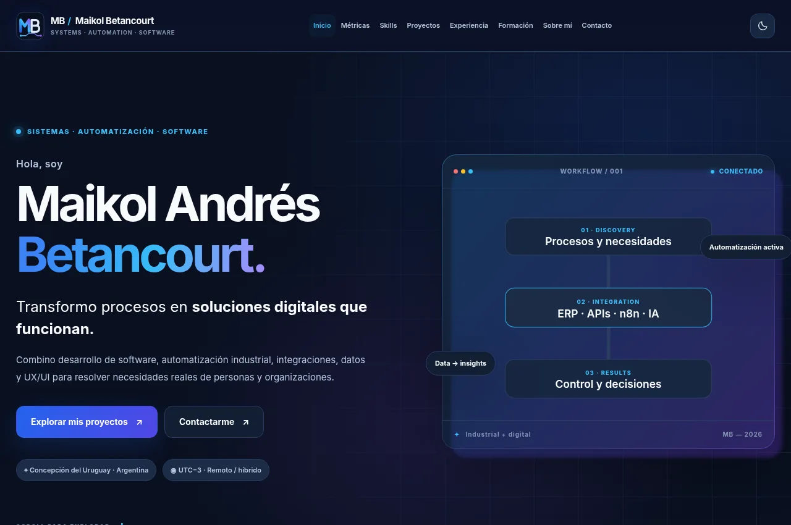
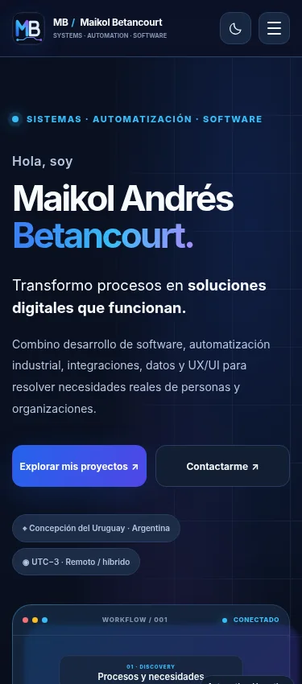
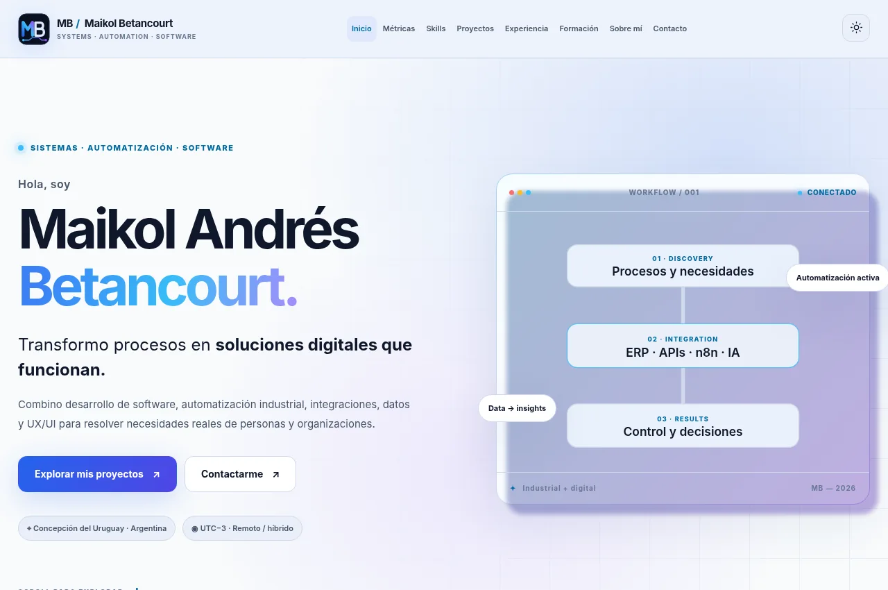

# Trabajo Final — Diseño UX/UI 2026

**Portfolio profesional de Maikol Andrés Betancourt** · Licenciatura en Sistemas de Información · FCyT-UADER · Mg. Ernesto Ledesma.

> **Estado:** versión Electric Flow (rediseño del portfolio profesional) implementada localmente y documentada. **No es una entrega final cerrada:** restan la página completa de alta fidelidad en Figma, tres pruebas reales con usuarios, revisión entre pares, publicación CI/CD y captura Lighthouse del sitio público. No se presentan resultados simulados como si fueran pruebas realizadas.

## Enlaces

- **Archivo Figma del trabajo:** https://www.figma.com/design/Ls1mpNP9BDDakTddtmAEDO
- **Sitio publicado:** pendiente de conectar Netlify con este repositorio y verificar HTTPS. No se inventa una URL.
- **SC Soluciones Conectadas:** https://scsolucionesconectadas.com.ar/
- **TP5 Cubrí Seguros:** https://tp5-seguros.netlify.app/


## Marca personal y sitio multipágina — Electric Flow

La identidad visual elegida por el autor es **MB / Maikol Betancourt — Systems · Automation · Software**. Se creó un monograma vectorial (`assets/img/mb-mark.svg`) y dos variantes horizontales (`mb-lockup-dark.svg` y `mb-lockup-light.svg`). La paleta utiliza **Deep Night `#0A1020`, Electric Blue `#2563EB`, Digital Violet `#8B5CF6`, Signal Cyan `#38BDF8` y Soft White `#F8FAFC`**.

Incluye botón de **modo claro/oscuro** con persistencia, animación de workflows, efecto de barrido en botones, halos en tarjetas y aparición progresiva al hacer scroll. El contenido permanece accesible con `prefers-reduced-motion`. Las animaciones son originales, tomando como referencia general [Uiverse](https://uiverse.io/elements), no es un template copiado. El apartado personal toma como referencia general de estructura la página «Nosotros» de Click, pero usa fotografía y textos propios.

**Conservamos las nueve secciones en `index.html` y un índice interno de navegación por anclas para cumplir la consigna one-page**, y agregamos páginas independientes para explorar el contenido en profundidad:

- `skills.html`: página independiente de habilidades con seis áreas y evidencias de aplicación.
- `sobre-mi.html`: retrato profesional propio y perfil orientado a oportunidades laborales.
- `proyectos.html`: seis proyectos, filtros y links a demos/casos.
- `experiencia.html`: recorrido laboral y cuatro áreas de Intellymation.
- `formacion.html`: educación y catálogo de certificaciones por categorías.
- `contacto.html`: vías de contacto y formulario que prepara un email con `mailto:` sin backend.
- `caso-sc.html`: recursos gráficos reales del proyecto público de SC, sin datos de terceros.
- `caso-agrimensura.html` y `caso-cubri.html`: casos de estudio independientes.

Se conservan HTML, CSS y JavaScript puro, sin frameworks de SPA, para cumplir las restricciones del trabajo. Ver [identidad, arquitectura y decisiones UX](docs/Electric-Flow-Identidad-y-UX.md).

## Iteración v5 — contenido diferenciado e ilustraciones originales

Se revisó la duplicación de biografía, tecnología y metodología entre Inicio, Sobre mí, Skills y Proyectos. Inicio conserva las 9 secciones mínimas del TP; las páginas individuales tienen funciones distintas. Se sumaron **seis ilustraciones SVG originales animadas** para las seis especialidades, dos diagramas de flujo conceptual en Skills y una secuencia de cinco pasos en Sobre mí. Proyectos reemplaza un bloque metodológico repetido por una galería de evidencia visual diferenciada entre recurso público de SC, captura auténtica de Cubrí y representación conceptual de ERP privado.

Todos los SVG están dentro de `assets/img/skill-*.svg` (regenerables con `python scripts/generate_skill_art.py`), son editables, se visualizan con fondos claros/oscuros y desactivan el movimiento al usar `prefers-reduced-motion`. Ver [plan editorial y visual v5](docs/Plan-editorial-visual-v5.md). **No se declara que una ilustración conceptual es captura real.**

## Objetivo

Mostrar de manera clara experiencia laboral, habilidades, formación y proyectos reales ante dos perfiles de usuario: reclutadores IT y clientes que buscan soluciones tecnológicas. El portfolio debe permitir identificar experiencia, abrir un proyecto y localizar contacto en menos de 30 segundos (hipótesis que se validará con usuarios).

## Certificados verificables y vistas de SC (iteración de portfolio)

- **Galería de 43 documentos**: 14 credenciales agrupadas por institución y 29 módulos AVEVA en un bloque desplegable. El filtro por especialidad se combina con búsqueda por texto.
- **Visor con `<dialog>` nativo**: abrir miniatura, navegar entre documentos visibles, cerrar con Escape, cerrar desde el botón y volver al elemento original. Los certificados IBM incluyen enlaces oficiales de Credly.
- **Protección de datos**: solo se versionan imágenes WEBP sin metadatos; el DNI de los certificados de Fundación YPF está oculto y no se añaden PDFs originales con información personal. El certificado inmobiliario se excluye por completo.
- **SC real sin exponer clientes**: `caso-sc.html` incorpora un explorador de demos en vivo cargadas **solo por acción del usuario**, con acceso alternativo directo a SC cuando el servidor remoto no permite incrustación. Las demos SC contienen datos ficticios.
- **Navegación híbrida**: el menú principal de **todas las páginas** abre archivos independientes (Inicio, Skills, Proyectos, Experiencia, Formación, Sobre mí y Contacto); `index.html` conserva un índice adicional de anclas a las secciones resumidas para respetar el requisito one-page del docente.

**Prueba local:** `python -m unittest discover -s tests -v`. La revisión de comportamiento con navegador y los resultados de Lighthouse siguen siendo comprobaciones independientes que no se sustituyen por tests estáticos.

## Contenido y estructura

El sitio conserva los **9 bloques obligatorios** de la consigna: `Header`, `Hero`, `Métricas`, `Skills`, `Proyectos`, `Experiencia / Formación`, `Sobre mí`, `Contacto` y `Footer`. Se integró un catálogo filtrable de certificaciones y dos páginas internas de casos de estudio:

- `caso-cubri.html`: caso académico UX/UI con capturas **reales** del TP5.
- `caso-agrimensura.html`: caso profesional con información general autorizable y mockup conceptual; **sin código ni datos privados**.

## Tecnologías

- HTML5 semántico.
- CSS3 puro, Grid, Flexbox, variables CSS y media queries.
- JavaScript vanilla (menú mobile, filtros y mejoras progresivas).
- Inter y Space Grotesk (Google Fonts, con `display=swap`).
- SVG propios, imagen WebP del autor, imágenes de la web original de SC (cargadas desde su repositorio público) y dos capturas WebP del TP5.
- Sin React, Vue, Next.js, Tailwind CDN ni herramientas de construcción visual de webs.

## Uso local

Desde esta carpeta:

```bash
python -m http.server 4173
```

Luego abrir `http://localhost:4173/`. También puede abrirse `index.html` directamente; las rutas relativas están preparadas para hosting estático. No requiere `npm install` ni claves privadas.

## Investigación UX y Figma

- **Proto-persona** y escenario de uso, definidos como hipótesis.
- **Benchmark** de Brittany Chiang, Adham Dannaway y Bruno Simon, con criterios y decisiones propias.
- **Sitemap / card sorting** con nueve bloques obligatorios.
- **Concepto visual:** Profesional · Tecnológico · Funcional.
- **Wireframes:** mobile 375 px y desktop 1440 px.
- **Design system:** 18 variables (colores/espaciado) y 6 estilos tipográficos en Figma; botones con cuatro estados, tags, tarjetas e ítems de timeline.
- **Alta fidelidad:** el sitio se rediseñó en Electric Flow, pero **aún debe sincronizarse el prototipo completo en Figma** y prototiparse la navegación antes de realizar los tests con usuarios.

El documento base está en [`docs/Hito1_Investigacion_UX.md`](docs/Hito1_Investigacion_UX.md), los tokens en [`docs/design-system.md`](docs/design-system.md) y las tareas en [`docs/guion-test-usabilidad.md`](docs/guion-test-usabilidad.md).


### Capturas Electric Flow — revisión local







Estas capturas pertenecen al navegador local sobre una renderización autocontenida; **no** son evidencia de un despliegue público ni capturas Lighthouse. Los recursos remotos de SC se sustituyen en esa revisión por su ilustración de respaldo porque el entorno de pruebas no tiene acceso a la red.

## Responsive y accesibilidad

Probado de forma automatizada con Chromium / Playwright en la versión Electric Flow (40 comprobaciones de páginas) sobre una renderización autocontenida del HTML en **375 px, 768 px, 1280 px y 1440 px**: sin scroll horizontal, con menú keyboard-friendly, filtros accesibles, un solo H1 y secciones de ancla presentes.

Incluye: enlace **Saltar al contenido**, estados `:hover`, `:focus-visible`, `:active`, `aria-expanded` y `aria-controls`, semántica, `lang=es-AR`, desactivación de animaciones con `prefers-reduced-motion` e imágenes con alt significativo.

**No hay todavía captura Lighthouse ni validación WCAG completa sobre el sitio alojado.** Queda pendiente realizar ambas y resolver los hallazgos. Archivo de comprobaciones: [`tests/test_portfolio.py`](tests/test_portfolio.py).

### Capturas de desarrollo


No son capturas de una URL publicada ni reemplazan la captura de Lighthouse que exige la consigna.

## Casos y privacidad

- ERP Agrimensura usa un **mockup conceptual**: el repositorio original es privado. No se publican sistemas ni datos del estudio.
- CRM Comercial se muestra como **en desarrollo**; no se afirma que esté publicado o completado.
- La sección de certificados utiliza títulos, instituciones, fechas y enlaces de verificación públicos cuando existen. Se crearon **previsualizaciones WebP preparadas**, sin incluir los documentos originales con datos de identificación. Los certificados YPF tienen oculto el DNI.
- Los demás mockups SVG son ilustraciones propias de la web, **no capturas reales** de los productos. Las imágenes de SC proceden del repositorio público del proyecto y se usan como recursos visuales reales de su landing, no como prueba de resultados de clientes.

## Deploy automático desde GitHub

Para utilizar Netlify con el repositorio de la materia, importar el repositorio y configurar:

1. **Base directory:** `Trabajo-Final-Portfolio`
2. **Build command:** dejar vacío.
3. **Publish directory:** `.` (desde la carpeta base).
4. Branch de producción: `main`.
5. Guardar y verificar que el deploy se actualice al realizar un nuevo push.

Se incluyó `netlify.toml` con 404 personalizado y cabeceras de seguridad. **La conexión debe quedar efectivamente activa antes de entregar.** Añadir después la URL final al README y verificar la vista previa de Open Graph. La imagen OG tiene URL absoluta apuntando al recurso público del repositorio.

## Uso de herramientas de IA

Este trabajo fue **asistido por ChatGPT/Codex** para estructurar contenidos, desarrollar HTML, CSS y JavaScript, crear SVG conceptuales, organizar el inventario de certificados y preparar pruebas automatizadas. El alumno debe revisar, corregir, interpretar y defender las decisiones de UX/UI y el código. Las pruebas con usuarios deben hacerse con personas reales; no se generan resultados ficticios.

No se utilizó un template de terceros para la implementación actual. Referentes del benchmark: [Brittany Chiang](https://brittanychiang.com/), [Adham Dannaway](https://www.adhamdannaway.com/) y [Bruno Simon](https://bruno-simon.com/). Google Fonts: Inter y Space Grotesk.

## Checklist de entrega

Ver [`docs/pendientes-entrega.md`](docs/pendientes-entrega.md) para el estado actualizado de los entregables de la consigna.


## Evidencias visuales reales de las demos SC (v6)

Se añadieron capturas locales de las interfaces públicas de SC Soluciones Conectadas (Salud, Hotelería y Logística) obtenidas del código original de `maicolandresb123/Mockups_Ventas`: HTML, CSS y JavaScript originales, renderizados en Chromium. La captura excluye el área de logo no disponible en el entorno sin conexión y muestra interfaces de ejemplo con **datos totalmente ficticios**. No son capturas de producción de clientes, ni se interpretan cifras simuladas como resultados comerciales reales.

Archivos: `assets/img/sc-demo-{medica,hoteleria,logistica}-interfaz.webp`. Se utilizan en Inicio, Proyectos y el caso de estudio SC, cuyo visor permite ampliación, navegación con flechas, Escape y restauración del foco. Las demos auténticas siguen disponibles mediante sus enlaces externos y visor bajo demanda.

El ERP Agrimensura y el CRM interno no se muestran como capturas reales mientras no existan imágenes autorizadas y anonimizadas de esos sistemas. Los SVG de esos proyectos están rotulados como conceptuales.

Se corrigió además un error tipográfico en la apertura de la colección AVEVA al buscar certificados.

## V7 — ERP, Coffea y auditoría frente al TP final

- Se incorporaron **capturas auténticas aportadas por el autor**: portada de Coffea y dos vistas del ERP Agrimensura. No se pudieron obtener capturas directas mediante navegador del entorno (sin acceso a URLs externas y ERP requiere sesión privada).
- Las vistas de Agrimensura fueron **anonimizadas** antes de incorporarse: usuario, contraseña y métricas operativas están difuminadas. Nunca se subieron los archivos originales al repositorio.
- El catálogo utiliza imágenes reales para ERP y Coffea. Se creó [`caso-coffea.html`](caso-coffea.html) y el caso de Agrimensura documenta dos interfaces.
- La página Inicio mantiene las nueve partes del TP y sus anclas de navegación **dentro del Header**, además de conservar enlaces a páginas independientes.
- Se añadieron aprendizajes en las tarjetas de los seis proyectos y se representa el resumen laboral como timeline ordenado.
- [Auditoría del trabajo final contra la consigna original](docs/Auditoria_TP_Final_2026_v7.md).
- [Referencias visuales para importación y sincronización futura de Figma](docs/figma-import/INSTRUCCIONES.md). **Figma no pudo actualizarse directamente**: el servicio devolvió límite de llamadas del plan Starter. No se presenta este material como prototipo final completado.
